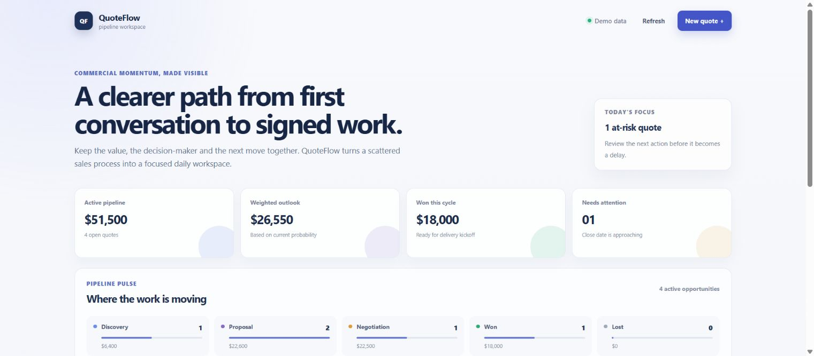
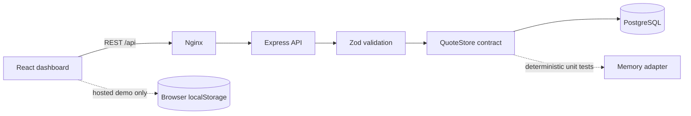

# QuoteFlow

> **Full Stack sales workspace for managing commercial quotes from discovery through closing.**  
> Developed by **Mohamed Ajmal** — *A curious developer working with real time projects*

[](.github/workflows/verify.yml)
[](LICENSE)
[](https://react.dev)
[](https://expressjs.com)
[](https://www.postgresql.org)

QuoteFlow is a full-stack commercial workspace for managing quotes from discovery through closing. It combines a responsive React dashboard with a typed Express API and durable PostgreSQL storage, giving a small commercial team one place to track value, risk and the next customer action.

This repository is built as a reviewable business application rather than a UI-only prototype: writes are validated, related records are committed transactionally, schema changes are versioned, demo data is reproducible and the PostgreSQL adapter is exercised in CI.

The hosted interactive version runs as an in-browser demo using fictional sample companies, keeping changes only in the visitor's browser. The full Express and PostgreSQL path remains available through Docker below.



## What it demonstrates

- A complete commercial workflow: quotes, stages, probability, close dates, tags and follow-ups.
- A React/TypeScript client consuming a versionable REST boundary.
- Express route adapters separated from storage through a `QuoteStore` contract.
- PostgreSQL persistence with constraints, indexes, transactions and cascading relationships.
- Repeatable SQL migrations and an idempotent seed workspace.
- Unit API tests plus a real PostgreSQL integration test.
- React Testing Library coverage for loading, search, quote creation and demo reset behavior.
- A Playwright browser journey proving that demo writes survive a reload and can be reset.
- A three-service Docker environment with Nginx, Node.js and PostgreSQL.

## Stack

| Layer | Technology |
| --- | --- |
| Web | React 19, TypeScript, Vite, responsive CSS |
| API | Node.js, Express 5, TypeScript, Zod |
| Data | PostgreSQL 16, `pg`, versioned SQL migrations |
| Quality | ESLint, Vitest, React Testing Library, Supertest, Playwright, strict TypeScript, GitHub Actions |
| Runtime | Docker Compose, multi-stage Docker build, Nginx |

## Product capabilities

- View active pipeline, weighted value, won value and at-risk work.
- Search quotes and filter them by stage or owner through the API.
- Create and update quotes with server-side validation.
- Progress work through discovery, proposal, negotiation, won and lost.
- Schedule follow-ups without losing the customer or quote context.
- Review upcoming work and aggregate pipeline activity by client.
- Keep changes after API or container restarts through a named PostgreSQL volume.

## Architecture



The HTTP contract does not know which adapter stores the data. Production-style runs select PostgreSQL through `DATABASE_URL`; isolated API tests inject `MemoryQuoteStore`. See [the architecture notes](docs/ARCHITECTURE.md) for transaction boundaries and design decisions.

The static GitHub Pages build selects a separate browser adapter at build time with `VITE_DEMO_MODE=true`. It implements the same UI-facing operations without shipping the Node server or suggesting that the demo has production persistence.

## Run the interactive browser demo locally

This mode needs only Node.js 20 or newer. Data is stored in your browser and can be restored from the notice at the top of the dashboard.

PowerShell:

```powershell
npm install
$env:VITE_DEMO_MODE="true"
npm run dev --workspace @quoteflow/web
```

macOS or Linux:

```bash
npm install
VITE_DEMO_MODE=true npm run dev --workspace @quoteflow/web
```

## Run the complete application with Docker

Prerequisites: Docker Desktop with Docker Compose.

```bash
docker compose up --build
```

Open `http://localhost:8080`. On its first start, the API applies pending migrations and loads the demo workspace. Subsequent starts reuse the `quoteflow-data` volume and the seed safely skips records that already exist.

Stop the services with:

```bash
docker compose down
```

The compose password is intentionally local-only. Use secret management and a unique credential in any hosted environment.

## Run in development mode

Prerequisites: Node.js 20 or newer and Docker.

```bash
npm install
docker compose up -d --wait database
```

Copy `.env.example` to `.env`, then prepare the database and start both workspaces:

```bash
npm run db:migrate
npm run db:seed
npm run dev
```

Open `http://localhost:5173`. The API listens on `http://localhost:3001`; Vite proxies `/api` and `/health` during development.

### Environment variables

| Variable | Required | Purpose |
| --- | --- | --- |
| `DATABASE_URL` | For PostgreSQL | PostgreSQL connection string |
| `POSTGRES_PORT` | No | Host port published by Compose; defaults to `5433` |
| `DATABASE_POOL_SIZE` | No | Maximum pool size; defaults to `10` |
| `DATABASE_SSL` | No | Set to `true` for providers requiring TLS |
| `PORT` | No | API port; defaults to `3001` |

Without `DATABASE_URL`, the API deliberately starts with its in-memory adapter for a zero-dependency preview. The health endpoint and list metadata always report the active mode, so a deployment cannot silently pretend to be persistent.

## Database lifecycle

```bash
npm run db:migrate   # apply only migrations not recorded previously
npm run db:seed      # insert the demo workspace idempotently
```

Migration files live in `apps/api/db/migrations`. Every migration is applied inside a transaction and recorded in `schema_migrations`.

## Verification

```bash
npm run lint
npm run build
npm test
npm run test:e2e
```

The regular suite uses isolated adapters and needs no infrastructure. It currently covers six frontend component/adapter scenarios and five API contract scenarios. The Playwright journey starts the browser demo, creates a quote, reloads the page to verify persistence and restores the original sample.

Install Playwright's Chromium once before the first local browser run:

```bash
npx playwright install chromium
```

To exercise the real persistence boundary locally:

```bash
docker compose up -d --wait database
npm run db:migrate
npm run test:integration
```

GitHub Actions performs lint, the production build, frontend and API tests, the Chromium journey, migrations, seed and the PostgreSQL persistence test on every push and pull request. A separate Pages workflow builds only the explicitly labelled browser demo.

## API overview

| Method | Endpoint | Purpose |
| --- | --- | --- |
| `GET` | `/health` | Check API and active storage availability |
| `GET` | `/api/quotes` | List quotes; accepts `stage`, `owner` and `search` |
| `GET` | `/api/quotes/:id` | Retrieve one quote and its follow-ups |
| `POST` | `/api/quotes` | Create a validated quote |
| `PATCH` | `/api/quotes/:id` | Update details or pipeline stage |
| `DELETE` | `/api/quotes/:id` | Delete a quote and cascade its follow-ups |
| `POST` | `/api/quotes/:id/follow-ups` | Schedule a follow-up transactionally |
| `GET` | `/api/analytics/overview` | Return pipeline, risk and upcoming work |
| `GET` | `/api/leads` | Aggregate pipeline activity by client |

Example:

```bash
curl "http://localhost:3001/api/quotes?stage=proposal&search=retail"
```

## Repository structure

```text
quote-flow-react-node/
|-- apps/
|   |-- api/
|   |   |-- db/migrations/       # versioned PostgreSQL schema
|   |   `-- src/                 # routes, adapters, migration and seed runners
|   `-- web/                     # React/Vite dashboard
|       |-- e2e/                 # Playwright browser journey
|       `-- src/*.test.ts(x)     # component and browser-adapter tests
|-- deploy/nginx.conf            # SPA hosting and API reverse proxy
|-- docs/ARCHITECTURE.md
|-- Dockerfile                   # API and web runtime targets
`-- docker-compose.yml           # web, API and PostgreSQL services
```

## Scope and security

QuoteFlow is a portfolio and local demonstration workspace. It intentionally does not claim production authentication or tenant isolation, and the API should not be exposed directly to the public internet. The public static demo contains no secrets or server connection and stores only fictional sample data in the visitor's browser. A hosted multi-user version should add an identity provider, organization-scoped authorization, rate limiting, secret rotation and audit events. Those concerns are kept explicit instead of being represented by a hard-coded “demo login.”

## Suggested review path

1. Open the interactive demo and confirm the browser-only notice.
2. Create a quote with a future close date.
3. Move it to negotiation and schedule a follow-up.
4. Reload the browser to confirm demo persistence, then restore the sample.
5. Run the Docker stack and restart the API container to confirm PostgreSQL persistence.
6. Inspect the migration, repository adapter and integration test that support that behavior.

## Developer & Maintainer

**Mohamed Ajmal**  
*A curious developer working with real time projects*

- **Focus**: Scalable full-stack systems, clean architecture, resilient data pipelines, and developer-friendly tooling.

## License

This project is licensed under the MIT License - see the [LICENSE](LICENSE) file for details.  
Copyright (c) 2026 **Mohamed Ajmal - A curious developer working with real time projects**.
